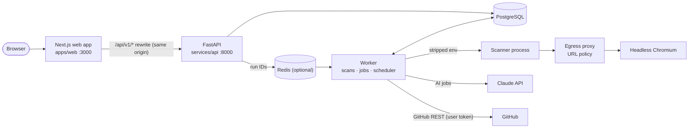

<div align="center">

# 🔧 Fixify

### Find bugs. Understand them. Fix them. Keep humans in control.

Fixify scans websites in a real browser, explains what broke with AI, and proposes code fixes that become GitHub pull requests only after a person approves them.


</div>

> [!IMPORTANT]
> Current status: **complete with limitations**. See [docs/status.md](docs/status.md) for what has been verified, what needs external credentials, and the remaining production blockers. Only scan websites you are authorized to test.

## What it does

| Step | What happens |
|---|---|
| 🔐 **Accounts** | Registration, email verification, login, password reset, sessions, account deletion. Every project belongs to one user. |
| 🕷️ **Scan** | A separate worker opens the site in headless Chromium and runs rule-based checks: navigation, console errors, exceptions, failed requests, HTTP errors, broken links, images, alt text, headings, meta description, mixed content, load time, and a screenshot. |
| 🧠 **Analyze** | AI (Claude by default) explains a finding from its recorded, sanitized evidence: summary, root cause, impact, solution, complexity, confidence, related code. |
| 🐙 **Connect GitHub** | OAuth, repository and branch selection. Files are read through the API, never cloned or executed. |
| 🛠️ **Propose a fix** | AI proposes search-and-replace edits against real files; Fixify validates them before anyone sees them. |
| 👀 **Review** | Side-by-side diff, approve, reject, comment, regenerate with feedback, reopen. |
| 🔀 **Pull request** | Approved fixes are committed to a new `fixify/…` branch and opened as a pull request. Fixify never merges. |
| 📊 **Track** | Dashboard, analytics from persisted data, in-app notifications, scheduled scans. |

## Architecture



Details: [docs/architecture.md](docs/architecture.md) · [docs/security.md](docs/security.md) · [docs/scanner.md](docs/scanner.md)

## Quick start

Prerequisites:

| | Required | Notes |
|---|---|---|
| Python | 3.12+ | for the API and worker (virtual environment in `services/api/.venv`) |
| Node.js / npm | 20.9+ | for the web app |
| PostgreSQL 17 | yes | self-managed: the Docker Compose service (the launcher starts it) or a native install |
| Docker + Compose | recommended | runs PostgreSQL and Redis (`infra/docker-compose.yml`) |
| Redis 7 | default | the scan queue; `QUEUE_BACKEND=database` is a fallback without Redis |

### 1. One-time setup

Windows (PowerShell):

```powershell
Copy-Item .env.example .env          # then edit DATABASE_URL (and optional AI / GitHub keys)
cd services/api
python -m venv .venv
.\.venv\Scripts\python.exe -m pip install -e ".[dev]"
.\.venv\Scripts\python.exe -m playwright install chromium
cd ../../apps/web
npm install
cd ../..
```

Linux / macOS:

```bash
cp .env.example .env                 # then edit DATABASE_URL (and optional AI / GitHub keys)
(cd services/api && python3 -m venv .venv && .venv/bin/pip install -e ".[dev]" && .venv/bin/python -m playwright install chromium)
(cd apps/web && npm install)
chmod +x fixify.sh
```

In `.env`, replace `POSTGRES_PASSWORD` (and the same password in `DATABASE_URL`) before the first start. If a native PostgreSQL already uses port 5432, set `POSTGRES_HOST_PORT=5433` and use port 5433 in `DATABASE_URL`. Database details, including importing data from an earlier database: [docs/development-setup.md](docs/development-setup.md). The web app needs no `.env.local`: the launcher points it at the API automatically.

### 2. Start everything with one command

```powershell
.\fixify.ps1 start                   # Windows
```

```bash
./fixify.sh start                    # Linux / macOS
```

The launcher validates `.env` and the tools, starts the PostgreSQL / Redis containers your `.env` needs, checks the database, Redis and pending migrations, then starts the API, the worker and the web app. Each step waits for a real health check. It then prints the URLs (by default <http://localhost:3000> for the app and <http://127.0.0.1:8000> for the API).

Run `.\fixify.ps1` or `./fixify.sh` without arguments for the interactive menu. The full reference is in [Local launcher](#local-launcher) below.

Open <http://localhost:3000>, create an account, and verify the email. With `EMAIL_BACKEND=console` the verification link is written to the API log (`.\fixify.ps1 logs api`). Then add a project and run a scan.

### Running the services by hand (alternative)

```powershell
docker compose --env-file .env -f infra/docker-compose.yml up -d postgres redis
cd services/api
.\.venv\Scripts\Activate.ps1
alembic upgrade head
python -m app.serve                  # API on http://127.0.0.1:8000
```

Second terminal (worker: scans, AI and GitHub jobs, scheduler):

```powershell
cd services/api
.\.venv\Scripts\Activate.ps1
python -m app.worker
```

Third terminal (web app):

```powershell
cd apps/web
Copy-Item .env.example .env.local
npm install
npm run dev                          # http://localhost:3000
```

> Projects created before authentication existed have no owner and are hidden. Assign them to your account with `python -m app.cli assign-orphans --email you@example.com`.

## Local launcher

`fixify.ps1` (Windows PowerShell 5.1 / 7) and `fixify.sh` (bash on Linux, macOS, WSL or Git Bash) are thin wrappers around one launcher, [`scripts/launcher/fixify.py`](scripts/launcher/fixify.py). It uses only the Python standard library, so both platforms behave the same and nothing has to be installed globally. The wrappers prefer the API virtual environment and fall back to a system Python, so `status` and `--help` work before setup is finished.

### Commands

| Windows | Linux / macOS | What it does |
|---|---|---|
| `.\fixify.ps1` | `./fixify.sh` | Interactive menu |
| `.\fixify.ps1 start [--migrate]` | `./fixify.sh start [--migrate]` | Full startup with health checks (see below) |
| `.\fixify.ps1 infra [--all]` | `./fixify.sh infra [--all]` | Only the PostgreSQL / Redis containers this `.env` needs (`--all`: both) |
| `.\fixify.ps1 stop [--keep-infra]` | `./fixify.sh stop [--keep-infra]` | Stop the web app, worker and API, then the containers the launcher started |
| `.\fixify.ps1 restart` | `./fixify.sh restart` | Restart the application services; containers are not recreated |
| `.\fixify.ps1 status` | `./fixify.sh status` | Tool versions, configuration, database, Redis, migrations and services |
| `.\fixify.ps1 logs [name] [-f] [-n 200]` | `./fixify.sh logs [name] [-f] [-n 200]` | `web`, `api`, `worker`, `postgres`, `redis` or `all` |
| `.\fixify.ps1 migrate [--yes]` | `./fixify.sh migrate [--yes]` | Show pending Alembic migrations and apply them |
| `.\fixify.ps1 open` | `./fixify.sh open` | Open the web app in the browser |
| `.\fixify.ps1 --help` | `./fixify.sh --help` | Help |

Exit codes: `0` success, `1` a check or service failed, `2` usage error, `130` interrupted.

### What `start` does

1. **Environment:** `.env`, the API virtual environment and `apps/web/node_modules` must exist. Required settings are checked, and optional ones (AI, GitHub) are reported as disabled. Only "configured" or "not set" is shown, never a value. The settings are loaded with the API's own configuration class, so validation errors match what the API would report.
2. **Tools:** Node.js 20.9+, npm, and Python 3.12+ in the virtual environment.
3. **Infrastructure:** a Compose container is started only when `DATABASE_URL` / `REDIS_URL` point at `localhost` on the published port (`POSTGRES_HOST_PORT` / `REDIS_HOST_PORT`, default 5432 / 6379) and nothing is already serving there. A native PostgreSQL, or `QUEUE_BACKEND=database`, needs no container. The launcher waits for the containers' health checks.
4. **Connectivity:** connects to PostgreSQL (`SELECT version()`) and pings Redis if the configuration uses it, with up to three attempts.
5. **Migrations:** compares the database revision with the Alembic head, read-only. If migrations are pending, it asks before applying them; with `--migrate` or `FIXIFY_AUTO_MIGRATE=1` it applies them without asking. Without a terminal and without either option, it stops and tells you to run `migrate`. It never starts the app on an outdated schema.
6. **API:** `python -m app.serve`. Ready when `GET /api/v1/health/ready` returns 200.
7. **Worker:** `python -m app.worker`. The worker has no HTTP endpoint, so it is ready when its log shows that the scan worker, job worker and scheduler started, with no error, and it is still running a few seconds later.
8. **Web app:** `next dev`, read from `apps/web/package.json`. Ready when `/` answers with a non-5xx status. The first compile can take up to a minute.

If a step fails, the launcher names the failing service, shows the last log lines, and stops every service that this run started. Services that were already running are left alone. Ports come from configuration: `API_HOST` / `API_PORT` (default `127.0.0.1:8000`), and `PORT` or the port in `PUBLIC_APP_URL` for the web app (default `3000`). `API_INTERNAL_URL` is passed to the web app unless `apps/web/.env.local` sets it.

### Processes, logs and safety

* Each service runs under a small supervisor ([`supervise.py`](scripts/launcher/supervise.py)) in its own process group, detached from the terminal, so services keep running after `start` returns or the terminal closes. Stop them with `stop`.
* `runtime/` holds the launcher state: PID **and** process creation time for each supervisor and service. A PID is acted on only if both still match, so a reused PID is never stopped. Stale state is detected and cleared automatically. The launcher never kills by port number, and if a port is busy it names the owning process and stops.
* `stop` is graceful first: Ctrl+Break on Windows, SIGINT on Linux/macOS. After 15 seconds it force-stops the service's own process tree. Containers are stopped with `docker compose stop`, only if the launcher started them. The launcher never runs `down -v` and never deletes a volume.
* Ctrl+C during `start` stops the services that run started. Ctrl+C while following logs only stops the log view.
* `logs/<service>.log` collects each service's output, with a header at every start and the exit reason at every stop. Files rotate at 10 MB. PostgreSQL and Redis logs come from `docker compose logs`.
* `runtime/` and `logs/` are git-ignored.

### Troubleshooting

| Symptom | Fix |
|---|---|
| `.env missing` | `Copy-Item .env.example .env` (Windows) or `cp .env.example .env`, then set `DATABASE_URL`. |
| `services/api/.venv missing` / `apps/web/node_modules missing` | Run the [one-time setup](#1-one-time-setup). |
| `password authentication failed` | The data volume was created with another `POSTGRES_PASSWORD`. Change the password with `ALTER USER`; never delete the volume (see [development-setup](docs/development-setup.md#database)). |
| `Docker is needed for local postgres, but the Docker daemon is not running` | Start Docker Desktop, or point `DATABASE_URL` at a running or hosted PostgreSQL. |
| `port 5432 is already used by another process` | A native PostgreSQL is running. Point `DATABASE_URL` at it, or stop it before using the container. |
| `port 3000 is already in use … node.exe` / `Another next dev server is already running` | A manually started `npm run dev` is still running. Stop it (Ctrl+C in its terminal). Next.js allows one dev server per project folder. |
| `pending migration(s)` | `.\fixify.ps1 migrate`, or `start --migrate`. |
| A service failed to start | `.\fixify.ps1 logs api` (or `worker` / `web`). The failure message also shows the last log lines. |
| Scripts are blocked: "running scripts is disabled on this system" | `powershell -ExecutionPolicy Bypass -File .\fixify.ps1 start`, or once: `Set-ExecutionPolicy -Scope CurrentUser RemoteSigned`. |

Launcher tests: `services\api\.venv\Scripts\python.exe -m unittest discover -s scripts/launcher/tests -v` (Windows), or `services/api/.venv/bin/python -m unittest discover -s scripts/launcher/tests -v` (Linux / macOS).

## Configuration

| Area | Required for | Settings | Guide |
|---|---|---|---|
| Database | everything | `DATABASE_URL` | [development-setup](docs/development-setup.md) |
| Sessions | production | `SECRET_KEY`, `PUBLIC_APP_URL` | [authentication](docs/authentication.md) |
| Email | verification and reset links | `EMAIL_BACKEND=smtp`, `SMTP_*` | [authentication](docs/authentication.md) |
| AI | analysis and fixes | `ANTHROPIC_API_KEY`, `AI_MODEL`, `AI_EFFORT` | [ai](docs/ai.md) |
| GitHub | repositories and pull requests | `GITHUB_CLIENT_ID`, `GITHUB_CLIENT_SECRET`, `TOKEN_ENCRYPTION_KEY` | [github-oauth](docs/github-oauth.md) |

Every setting, with its default and bounds, is in [services/api/.env.example](services/api/.env.example). Never put secrets in `NEXT_PUBLIC_*` variables; the web app needs only the server-side `API_INTERNAL_URL`.

## Checks

```powershell
cd services/api; .\.venv\Scripts\Activate.ps1; pytest; ruff check .; alembic check
cd apps/web; npm run lint; npm run typecheck; npm test; npm run build
services\api\.venv\Scripts\python.exe -m unittest discover -s scripts/launcher/tests   # from the root
```

See [docs/testing.md](docs/testing.md) for what each suite covers (including the PostgreSQL migration test and the browser end-to-end run), and [docs/deployment.md](docs/deployment.md) before deploying anywhere shared.

## Continuous integration

GitHub Actions runs [`.github/workflows/ci.yml`](.github/workflows/ci.yml) on pushes and pull requests targeting `main` or `development`, and on manual dispatch. Jobs run in parallel and the final **CI result** job fails unless every required check succeeds.

The workflow validates the frontend (ESLint, TypeScript, unit tests, production build), backend (Ruff lint and formatting, pytest, launcher tests), Alembic migrations on a fresh PostgreSQL database, and the scanner with Chromium against local fixtures. A separate PostgreSQL + Redis job runs the full browser workflow through the real worker and queue. Its AI provider and GitHub API are deliberately mocked; real Claude and GitHub credentials are neither required nor verified. Docker builds the API, worker, and web images for validation only; it does not publish or deploy them.

Security checks include npm and Python dependency audits, GitHub Actions linting and static analysis, Gitleaks secret scanning, and a check for tracked non-example `.env` files. All Actions are pinned to commit SHAs. No repository secrets or extra variables are required; CI uses only disposable service credentials and the read-only default GitHub token.

To inspect a run, open the repository's **Actions** tab, select the failed run and job, then expand the failing step. For local equivalents and the disposable database/browser setup, see [docs/testing.md](docs/testing.md). To make CI a merge requirement, enable branch protection for `main` and require the **CI result** status check. `development` is also configured as a trigger and can be protected if that branch is created.

The workflow has been implemented locally but has not yet been verified by a remote GitHub Actions run. A local `npm audit` on 2026-11-05 found 8 existing advisories (1 high, 7 moderate); the high-severity Zod fix requires a major-version upgrade, so dependencies were not automatically changed. The CI audit will also report the Python dependency state.

## Docker images

| Image | Dockerfile | Notes |
|---|---|---|
| API | `services/api/Dockerfile` | `python:3.12-slim`, non-root (`fixify`), health check on `/api/v1/health` |
| Worker | `services/api/Dockerfile.worker` | Playwright base image with Chromium, non-root (`pwuser`); no published ports |
| Web | `apps/web/Dockerfile` | multi-stage `node:22-alpine`, non-root (`node`), health check on `/login` |
| Migrations | Compose service `migrate` | one-shot `alembic upgrade head`; the API and worker start only after it succeeds |

The full container stack: `docker compose --env-file .env -f infra/docker-compose.yml --profile app --profile worker up -d --build`. No secrets are copied into images (`.dockerignore` excludes `.env*`); configuration comes from the environment.

> Behind a TLS-inspecting firewall (for example a Fortinet or Zscaler proxy), `npm ci` and `pip install` inside the build fail with `unable to verify the first certificate`. Do not disable TLS verification. Build on a network without inspection, or add the organisation's root CA to the build environment.

## Documentation

[Architecture](docs/architecture.md) · [Scanner](docs/scanner.md) · [Security](docs/security.md) · [Authentication](docs/authentication.md) · [AI](docs/ai.md) · [GitHub OAuth](docs/github-oauth.md) · [API](docs/api.md) · [Development setup](docs/development-setup.md) · [Testing](docs/testing.md) · [Deployment](docs/deployment.md) · [Status and limitations](docs/status.md)
